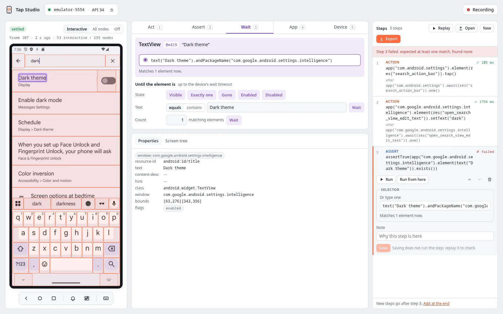
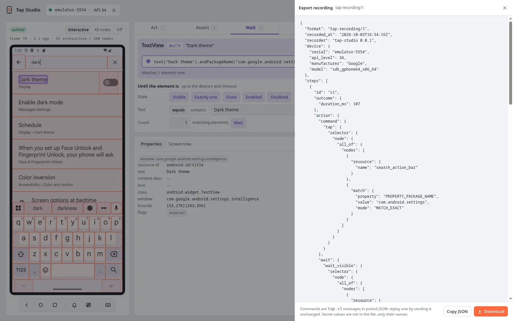

# Steps and export

## Editing steps

Click a step to open it:

{ width="1600" height="1000" }

- **Selector:** choose another candidate, or type a selector in the Kotlin DSL
  (`res("search").hasAncestor(res("toolbar"))`, `text("Add").at(1)`). A recorded selector
  usually ends in `.andPackageName("com.example.basket")`: the package of the element's app,
  which a test writes as `app("com.example.basket").element(…)`. Remove it to match on the
  whole screen. The line below shows how many elements the selector matches on the current
  screen.
- **Value and secret:** change the text of a set text or type step, or make it secret, and
  the expected text of a text wait or assertion, or the condition of an **Until** wait.
- **Scroll until:** change the selector of the element a scroll until brings into view, its
  direction, its distance and its maximum number of scrolls.
- **Gesture:** change a swipe's or scroll's direction/distance, a counted tap's count/interval,
  or a physical hold's duration. A scroll-until budget of zero only checks for its target.
- **Execution budgets:** edit supported command, selector-precondition and typing-focus budgets
  separately (1..120000 whole milliseconds). Empty uses the SDK default. Assertions still query
  once; their command budget does not wait for the condition to become true.
- **Screen stability:** edit the package (empty means whole screen), tree/pixels/both signal and
  quiet period (1..30000 milliseconds).
- **Note:** a free-text note, kept in the file.
- **Run** runs the step alone. **Run from here** runs it and every step after it. Move up, move
  down and delete are there too.

New steps go after the selected step, or at the end when none is selected. **Defaults for new
steps**, at the top of the composer, supplies phase budgets for subsequent supported steps.
Keys and fixed-budget device calls keep their SDK budgets. These are separate phase budgets,
not one total deadline; host-poll/search budgets are checked between SDK calls and an in-flight
call retains its own SDK budget. Focus does not prove that the keyboard is ready.

## Replay

**Replay** runs every step from the first and stops at the first failure. The failed step shows
the driver's error. If the recording does not start with an app step, the page offers to cold
launch the app first, because a replay from an unknown screen is not reproducible. Steps with
secrets ask for the values before the run. The values are kept only while the studio runs.

## Export and open

**Export** shows `tap-recording/2` JSON, with **Copy JSON** and **Download**. **Open** also accepts
legacy `/1` files and upgrades them to `/2`. Older Studio refuses `/2` rather than silently
ignoring the added typing, element-wait, assertion and scroll budgets. **New** starts an empty
recording; New and Open ask before discarding steps. The screenshot below shows the older `/1`
export UI.

{ width="1600" height="1000" }

```json
{
  "format": "tap-recording/2",
  "recorded_at": "2026-09-30T09:12:44Z",
  "recorder": "tap-studio 0.1.0",
  "device": {"serial": "emulator-5554", "api_level": 34, "manufacturer": "Google", "model": "sdk_gphone64_x86_64"},
  "steps": [
    {"id": "s1", "app": {"operation": "cold_launch", "package_name": "com.example.basket"}},
    {"id": "s2", "action": {
      "command": {"set_text": {"selector": {"node": {"all_of": {"nodes": [{"resource": {"name": "search"}},
        {"match": {"property": "PROPERTY_PACKAGE_NAME", "value": "com.example.basket", "mode": "MATCH_EXACT"}}]}}}, "text": "wool"}},
      "wait": {"wait_visible": {"selector": {"node": {"all_of": {"nodes": [{"resource": {"name": "search"}},
        {"match": {"property": "PROPERTY_PACKAGE_NAME", "value": "com.example.basket", "mode": "MATCH_EXACT"}}]}}}, "exactly_one": true}},
      "selector_origin": "SELECTOR_ORIGIN_SYNTHESIZED"}},
    {"id": "s3", "wait": {"selector": {"node": {"match": {"property": "PROPERTY_TEXT", "value": "3 results"}}},
      "condition": "CONDITION_VISIBLE"}},
    {"id": "s4", "assertion": {"selector": {"node": {"resource": {"name": "checkout"}}},
      "check": "CHECK_ENABLED"}}
  ]
}
```

Steps carry `tap.v1` messages in proto3 JSON, the same encoding as the
[gRPC API](../reference/grpc.md). Any language can read them, and a step replays by sending
its messages unchanged: an action's `wait`, then its `command`. The file records the device it
was made on, but it replays on any device. It never contains a secret's value, only its name
(`"secret": "password"`, listed in `secrets` at the top).

## Turning a recording into a test

The studio does not generate code. A recording maps one to one onto the client APIs, so you,
or a coding agent ([Tap agent](../agent/index.md)), write the test from it:

| Step | Kotlin | Python |
|---|---|---|
| `app` `cold_launch` | `app.coldLaunch()` | `app.cold_launch()` |
| `action` `multi_tap` | `element.tap(count = 3, interval = 100.milliseconds)` | `element.tap(count=3, interval=0.1)` |
| `action` `hold` | `element.longTap(duration = 1200.milliseconds)` | `element.long_tap(duration=1.2)` |
| `action` `set_text` on `res("search")` in `com.example.basket` | `app.await(res("search")).one().setText("wool")` | `app.wait(res("search")).one().set_text("wool")` |
| `wait` `CONDITION_VISIBLE`, no package | `device.screen.await(text("3 results")).visible()` | `device.screen.wait(text("3 results")).visible()` |
| `wait` `CONDITION_UNTIL`, `until` enabled and text `"Pay"` | `….await(res("pay")).until(enabled() and text("Pay"))` | `….wait(res("pay")).until(enabled() & text("Pay"))` |
| `assertion` `CHECK_ENABLED` | `assertTrue(device.screen.element(res("checkout")).isEnabled())` | `assert device.screen.element(res("checkout")).is_enabled()` |
| `assertion` `CHECK_TEXT_EQUALS` `"Wool"` | `assertEquals("Wool", ….text())` | `assert ….text() == "Wool"` |
| `scroll_until` on `res("list")`, target `text("Row 40")` | `….element(res("list")).scrollUntil(text("Row 40"))` | `….element(res("list")).scroll_until(text("Row 40"))` |
| `app_wait` `wait_app_visible` / `wait_screen_stable` | `app.awaitVisible()` / `app.awaitScreenStable()` | `app.await_visible()` / `app.await_screen_stable()` |
| `action` `set_orientation` (no selector) | `device.setOrientation(Orientation.LANDSCAPE)` | `device.set_orientation(Orientation.LANDSCAPE)` |
| `device_wait` `await_toast` | `device.awaitToast("Saved")` | `device.await_toast("Saved")` |
| `device` `set_animations` | `device.setAnimations(false)` | `device.set_animations(False)` |
| `device_assertion` `DEVICE_CHECK_KEYBOARD_SHOWN` | `assertTrue(device.keyboardShown())` | `assert device.keyboard_shown()` |

A selector whose top-level conjunction has a `PROPERTY_PACKAGE_NAME` match is that app's:
`app = device.app("com.example.basket")`, and the rest of the selector goes to
`app.element` / `app.await`. A selector without one is `device.screen`'s. The step list shows
each step that way.

Keep the selectors the studio chose: they matched exactly one element when the step was
recorded, and replay proved them.

## Run a recording without the page

`tap-studio replay` runs a recording on a device with no browser, using the same steps and checks as
the page. It needs a running server (`tap start`), which it never starts itself:

```bash
export CHECKOUT_PASSWORD=...
tap-studio replay checkout.tap-recording.json --serial emulator-5554 \
  --param user=ada --secret password=CHECKOUT_PASSWORD --results run.json
```

- `--param NAME=VALUE` replaces a declared parameter's value for this run.
- `--secret NAME=ENV_VAR` names the environment variable holding a secret's value, so the value
  stays out of your shell history and process list.
- `--from-step ID` starts at that step.
- `--results FILE` writes the run's results to a new file. It never replaces an existing one.
- `--evidence-dir DIR` saves a screenshot, hierarchy and device logs after a failure. These can show
  private data, so nothing is captured unless you ask.

Everything is checked before the device is touched. It stops at the first failure and retries
nothing.

| Exit code | Meaning |
| --- | --- |
| 0 | Every step passed |
| 1 | A step failed |
| 2 | The recording or the options are wrong, and nothing ran |
| 3 | No server, or the device could not be attached, and nothing ran |
| 130 | Interrupted. The running step may have sent its input, and it is not retried |

## Export a pytest file

The export drawer's **pytest** view, or this command, writes a recording as a pytest file on the
`tap-e2e` client's public API, using the plugin's `tap_device` fixture:

```bash
tap-studio export checkout.tap-recording.json -o test_checkout.py
pytest test_checkout.py
```

The file makes the same SDK calls a replay does, including every step's budgets. Parameters become
constants at the top of the file. Each secret comes from an environment variable named in the file's
docstring (`password` is `TAP_SECRET_PASSWORD`), read before any input. The test does not start the
server and retries nothing. A recording the exporter cannot write exactly is refused, rather than
exported with something missing.
